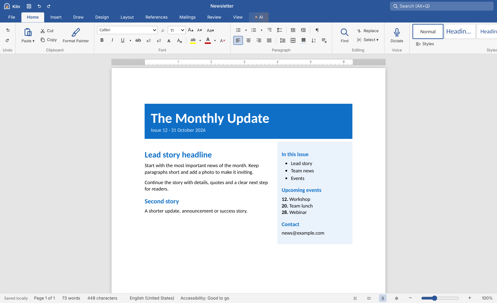
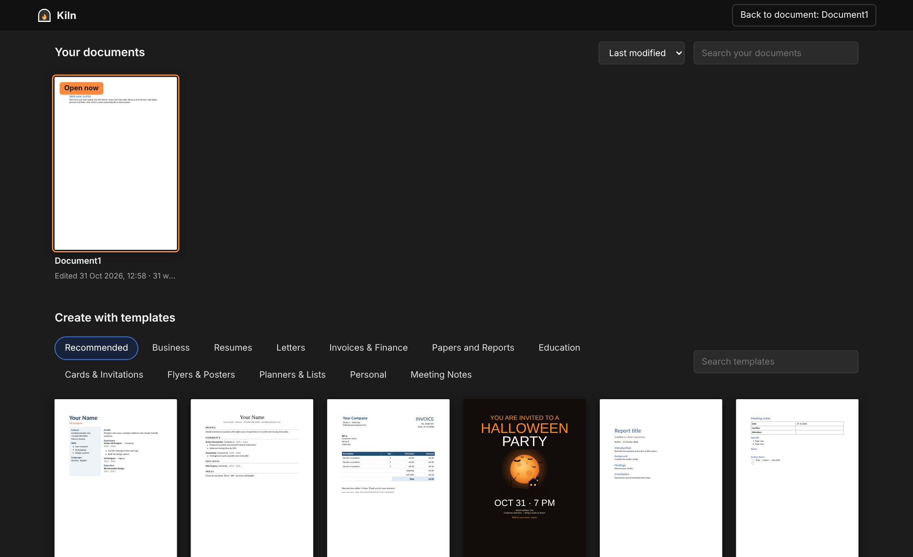
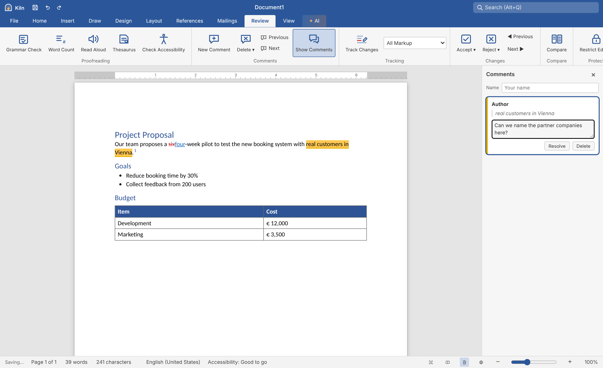
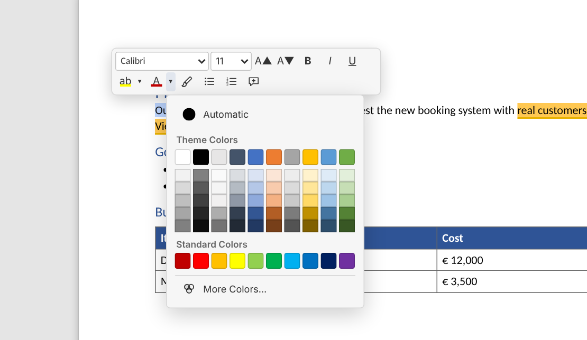
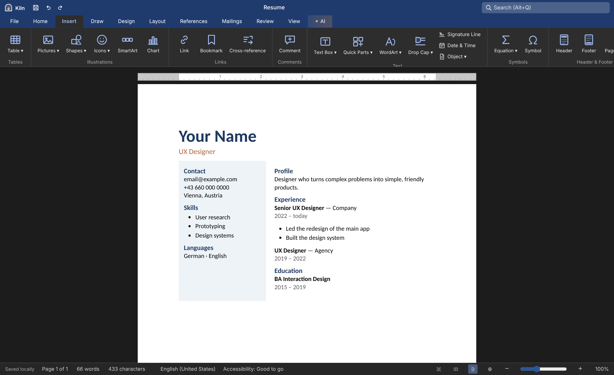

# Kiln

**A complete word processor in a single HTML file.**

Write, format and review documents right in your browser — open and save Word `.docx` files, 
export PDF and Markdown, and keep everything private on your own device.

[**▶ Try it live**](https://brickey8171.github.io/Kiln/) &nbsp;·&nbsp;
[Features](#-features) &nbsp;·&nbsp;
[Getting started](#-getting-started) &nbsp;·&nbsp;
[Shortcuts](#%EF%B8%8F-keyboard-shortcuts) &nbsp;·&nbsp;
[Privacy](#-privacy)

 

---

## ✨ Why Kiln?

- **One file, zero setup.** Double-click `index.html` or host it on GitHub Pages. No build step, no server, no sign-up.
- **Feels like the office suite you know.** Ribbon with tabs, styles gallery, right-click menu, Mini Toolbar, status bar, keyboard shortcuts.
- **Real Word compatibility.** Opens and saves `.docx` with headers & footers, tables, tracked changes, comments, footnotes, themes and more.
- **Private by default.** Your documents are stored in your browser and never uploaded anywhere.
- **Bilingual.** Full English and German interface.

## 📸 Screenshots

<table>
  <tr>
    <td width="50%"> <b>Start screen</b> — your saved documents and 59 templates in 12 categories</td>
    <td width="50%"> <b>Review</b> — track changes, comments and footnotes</td>
  </tr>
  <tr>
    <td width="50%"> <b>Mini Toolbar</b> — formatting right where you select text</td>
    <td width="50%"> <b>Dark mode</b> — easy on the eyes, the page stays white</td>
  </tr>
</table>

## 🧰 Features

<b>✍️ Writing & formatting</b>

- Fonts, sizes, bold/italic/underline (single, double, dotted, wavy…), strikethrough, sub/superscript, small caps, all caps, hidden text
- Word-style colour palettes for font and highlight colours, text effects (shadow, outline, glow)
- **Font** and **Paragraph** dialogs: character spacing, indents, hanging indent, line & paragraph spacing, keep with next, page break before
- Styles gallery and **Styles pane** — modify styles or update them to match your selection
- Bullets, numbering, multilevel lists (incl. `1.1.1` legal numbering), checklists
- Format Painter, change case, borders and shading, sort, find & replace, Go To
- AutoCorrect, live grammar & spelling check, dictation and read aloud

<b>➕ Insert</b>

- Tables (grid picker, quick tables, convert text ↔ table, formulas like `=SUM(ABOVE)`)
- Pictures from **this device** or **online search** (openly licensed images via Openverse / Wikimedia Commons)
- Shapes, icons, **SmartArt** diagrams and **charts** (column, bar, line, area, pie) — editable any time
- Text boxes, WordArt, drop caps, equations (LaTeX-style input), symbols, signature lines
- Links, bookmarks, cross-references, page breaks, blank pages, cover pages
- Headers, footers and page numbers, live date fields, Quick Parts

<b>🎨 Design & layout</b>

- Themes, theme colours and fonts, style sets, paragraph spacing presets — *Set as Default* for new documents
- Watermarks, page colour, page borders
- Paper sizes (A3–A5, Letter, Legal, envelopes…), orientation, custom margins
- Columns, column breaks, line numbers, automatic hyphenation

<b>📚 References</b>

- Table of contents, footnotes and endnotes
- Citations & bibliography in **APA, MLA, Chicago, Harvard and IEEE**
- Captions, table of figures, index, and **Update All (F9)**

<b>✉️ Mailings</b>

- Mail merge from a pasted list or a `.csv` file — merge fields, address block, greeting line
- Preview each recipient, then merge to a new document, print or PDF
- Envelopes and Avery-style address labels

<b>🔍 Review</b>

- **Track changes** with accept/reject and markup views
- Comments with resolve, delete and previous/next navigation
- **Compare** two versions — differences appear as tracked changes
- Thesaurus, accessibility checker, word count, restrict editing

<b>👀 Views</b>

- Print Layout, **Read Mode**, Web Layout, **Outline** (promote, demote, move), Draft
- Immersive Reader with line focus, text spacing and page colours
- Multiple pages, side-to-side, zoom, ruler, gridlines, navigation pane, focus mode, dark mode

<b>📁 Files & more</b>

- **Start screen** with your documents and **59 templates** — resumes, letters, invoices, reports, flyers, invitations, planners and more
- Autosave to your browser, **version history** (restore any earlier version)
- Document properties, document inspector, share
- Search box for every command (<kbd>Alt</kbd>+<kbd>Q</kbd>), collapsible ribbon
- Optional **AI assistant** — rewrite, summarise, translate, proofread and custom add-ins using your own API key (Anthropic Claude or any OpenAI-compatible server, including local ones like Ollama)

### File formats

| Format | Open | Save | Notes |
| --- | :---: | :---: | --- |
| Word `.docx` | ✅ | ✅ | Tables, images, headers/footers, comments, tracked changes, footnotes, styles, themes |
| PDF | — | ✅ | Downloads directly with selectable text, no print dialog |
| Markdown `.md` | ✅ | ✅ | Headings, lists, tables, links, footnotes |
| HTML | ✅ | ✅ | |
| Plain text `.txt` | ✅ | ✅ | |

## 🚀 Getting started

### Use it online

Open **[brickey8171.github.io/Kiln](https://brickey8171.github.io/Kiln/)** — nothing to install.

### Use it locally

1. Download **[`index.html`](https://github.com/Brickey8171/Kiln/raw/main/index.html)** (or clone the repo: `git clone https://github.com/Brickey8171/Kiln.git`).
2. Open it in a modern browser (Chrome, Edge, Firefox or Safari).
3. Start writing. That's it.

You can also drag a `.docx`, `.md`, `.html` or `.txt` file onto the page to open it.

### Host it on GitHub Pages

1. [Fork this repository](https://github.com/Brickey8171/Kiln/fork) (or create your own and add `index.html`).
2. Go to **Settings → Pages**, choose your branch and folder, and click **Save**.
3. Your editor is live at `https://<your-username>.github.io/<repository>/`.

No configuration is needed — Kiln is a static page.

## 🔒 Privacy

- Documents, settings and version history are saved **only in your browser** (IndexedDB / localStorage).
- Nothing is uploaded, and there are no analytics or trackers.
- A few optional features contact a service **only when you use them**:

| Feature | Service | What is sent |
| --- | --- | --- |
| Online pictures | Openverse / Wikimedia Commons | Your search words |
| Thesaurus | Datamuse (EN) / OpenThesaurus (DE) | The word you look up |
| Online grammar check (opt-in) | LanguageTool | The document text |
| AI assistant | The provider *you* configure | The text you choose to send |

> 💡 Because storage is per browser, download a `.docx` from time to time as a backup, or to move documents to another device.

## ⌨️ Keyboard shortcuts

| Action | Shortcut | | Action | Shortcut |
| --- | --- | --- | --- | --- |
| Bold / Italic / Underline | <kbd>Ctrl</kbd>+<kbd>B</kbd> / <kbd>I</kbd> / <kbd>U</kbd> | | Font dialog | <kbd>Ctrl</kbd>+<kbd>D</kbd> |
| Align left / center / right / justify | <kbd>Ctrl</kbd>+<kbd>L</kbd> / <kbd>E</kbd> / <kbd>R</kbd> / <kbd>J</kbd> | | Grow / shrink font | <kbd>Ctrl</kbd>+<kbd>Shift</kbd>+<kbd>&gt;</kbd> / <kbd>&lt;</kbd> |
| Find / Replace | <kbd>Ctrl</kbd>+<kbd>F</kbd> / <kbd>H</kbd> | | Go To page | <kbd>Ctrl</kbd>+<kbd>G</kbd> |
| Insert link | <kbd>Ctrl</kbd>+<kbd>K</kbd> | | Page break | <kbd>Ctrl</kbd>+<kbd>Enter</kbd> |
| New comment | <kbd>Ctrl</kbd>+<kbd>Alt</kbd>+<kbd>M</kbd> | | Track changes | <kbd>Ctrl</kbd>+<kbd>Shift</kbd>+<kbd>E</kbd> |
| Footnote / Endnote | <kbd>Ctrl</kbd>+<kbd>Alt</kbd>+<kbd>F</kbd> / <kbd>D</kbd> | | Update all fields | <kbd>F9</kbd> |
| Spelling / Thesaurus | <kbd>F7</kbd> / <kbd>Shift</kbd>+<kbd>F7</kbd> | | Change case | <kbd>Shift</kbd>+<kbd>F3</kbd> |
| Copy / apply formatting | <kbd>Ctrl</kbd>+<kbd>Shift</kbd>+<kbd>C</kbd> / <kbd>V</kbd> | | Show ¶ marks | <kbd>Ctrl</kbd>+<kbd>Shift</kbd>+<kbd>8</kbd> |
| Search commands | <kbd>Alt</kbd>+<kbd>Q</kbd> | | Show / hide ribbon | <kbd>Ctrl</kbd>+<kbd>F1</kbd> |
| Save as `.docx` | <kbd>Ctrl</kbd>+<kbd>S</kbd> | | Print | <kbd>Ctrl</kbd>+<kbd>P</kbd> |

The full list is under **View → Help**. On macOS use <kbd>Cmd</kbd> instead of <kbd>Ctrl</kbd>.

## 🛠 How it works

Kiln is plain HTML, CSS and JavaScript in one file, with no framework and no build step.

- **Editing** — a `contenteditable` document, split into real pages by a custom paginator
- **Word files** — a hand-written `.docx` reader and writer (OOXML) on top of the bundled [JSZip](https://stuk.github.io/jszip/)
- **PDF** — pages rendered with [html2canvas](https://html2canvas.hertzen.com/) plus an invisible text layer, so text stays selectable and searchable
- **Storage** — IndexedDB for documents and versions, localStorage for settings

## ⚠️ Known limitations

- Very complex Word layouts (floating text boxes, section-specific page setups, embedded objects) are simplified on import.
- Charts, SmartArt and shapes are saved to `.docx` as pictures — editable in Kiln, but not as native objects in Word.
- PDF export needs an internet connection the first time, to load html2canvas.
- Some browser shortcuts (e.g. <kbd>Ctrl</kbd>+<kbd>1</kbd>) can't be overridden by a web page.

## 🙏 Credits

- [JSZip](https://github.com/Stuk/jszip) and [html2canvas](https://github.com/niklasvh/html2canvas) (MIT)
- [Openverse](https://openverse.org) and [Wikimedia Commons](https://commons.wikimedia.org) for openly licensed images
- [Datamuse](https://www.datamuse.com/api/), [OpenThesaurus](https://www.openthesaurus.de) and [LanguageTool](https://languagetool.org)
- Fonts by [Google Fonts](https://fonts.google.com)

## 📄 License

Released under the [MIT License](LICENSE) — free to use, modify and share.

 Made with 🔥 by <a href="https://github.com/Brickey8171">Brickey8171</a> — <b>Kiln</b>: where documents take shape. Found a bug or have an idea? <a href="https://github.com/Brickey8171/Kiln/issues">Open an issue</a>.

